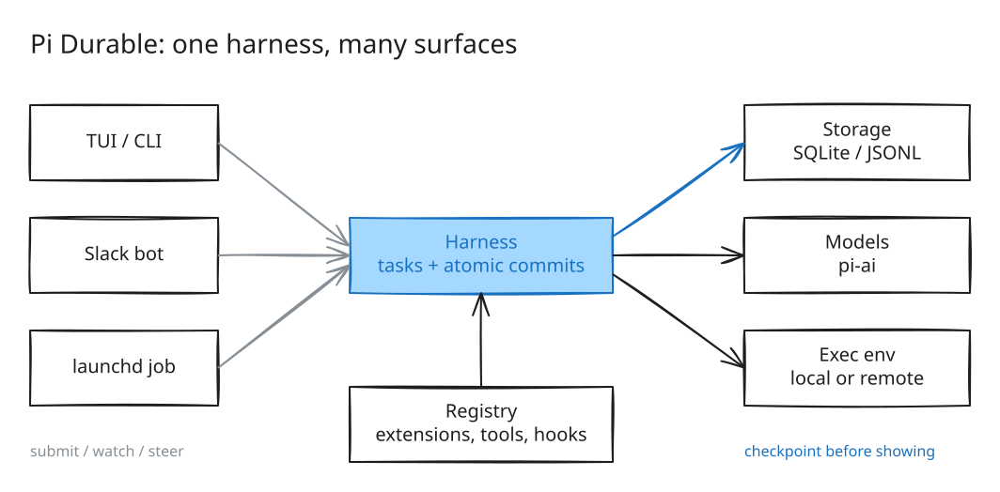
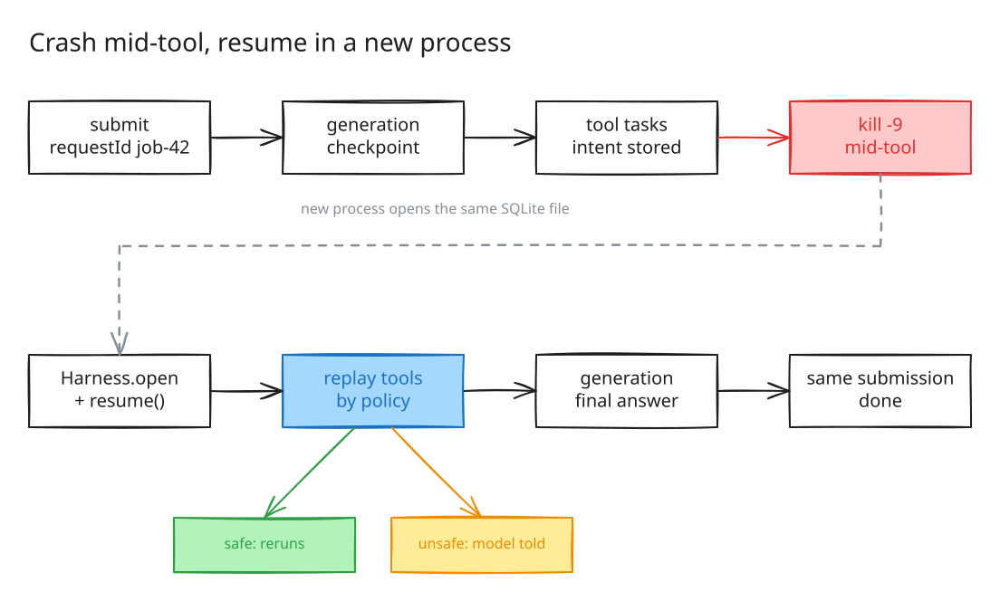
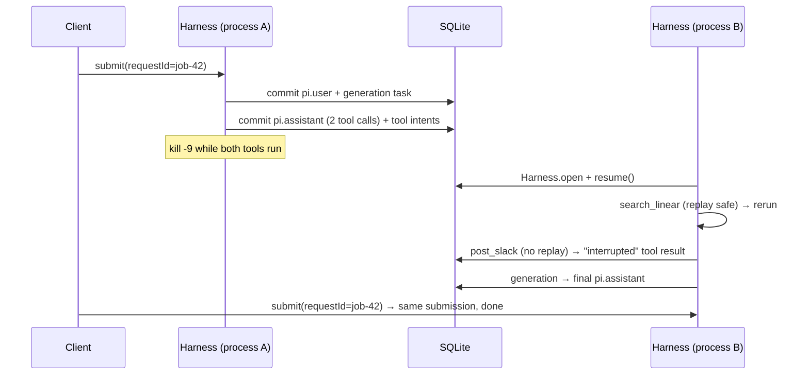

Date: 2026-10-24 · pi 1.4.0 · `@earendil-works/pi-durable` 1.4.0 (experimental)

Sources: the [Pi Durable launch post](https://earendil.com/posts/pi-durable/), the
[package README](https://github.com/earendil-works/pi/tree/main/packages/durable), the
installed package in `/tmp/durable-lab`, and your own files: `~/.pi/agent` (settings,
extensions, prompts, agents), `~/.agents/skills`, and all 271 session files.

## 1. What Pi Durable is

Pi Durable is **not a new version of the pi coding agent.** It's a TypeScript framework
for building agent apps (coding agents, Slack bots, triage bots, planners) whose
conversations survive crashes, run in parallel, and can be watched and steered by several
clients at once. It shares `pi-ai` and the minimal design with pi, and it's about 15k lines.
The pi CLI you use stays the same.

Core ideas:

| Concept | What it means |
| --- | --- |
| **Harness** | Opens one storage backend (memory, SQLite, JSONL, or your own) and runs every conversation on it. All writes go through atomic commits, and nothing is shown before its commit is stored. |
| **Conversation** | A transcript of immutable entries (`pi.user`, `pi.assistant`, `pi.tool-result`, `pi.system`, …). Can be forked at any entry without copying. Each one stores its own agent: model, thinking level, extensions, tools, instructions, cwd. |
| **Task** | A durable state machine that saves a checkpoint at every phase. Model calls (`pi.generation`), tool calls (`pi.tool`), and compaction are built-in tasks. You can define your own, with `sleepUntil` timers that survive restarts and waits on other tasks. |
| **Ownership tree** | Each task or conversation is owned by a conversation or a task. Aborting something aborts what it owns, bottom-up. **Background** tasks keep running after the turn that started them. |
| **Submission** | Input you hand to a conversation. A `requestId` makes it exactly-once, so a retry after a crash returns the original. `whenBusy: "steer"` injects input into a running turn. |
| **Tool replay policy** | A tool's intent is stored before it runs. After a crash it reruns only if it's marked `replay: "safe"`. Otherwise the model gets an "interrupted, may have partially run" result and decides what to do. |
| **Extension** | A named bundle of system prompt sections, tools, hooks (`beforeTool`, `afterTool`, `beforeRequest`, `onYield`, …), wrappers, and tasks. It can be hot-swapped while running. Hooks store decisions with `api.memo` so a crash doesn't ask twice. |
| **Documents** | Typed JSON app state (todos, plans, tickets) committed atomically with the transcript. Forks see the right version. |
| **Compaction** | A background task that summarizes old context before the window fills. If a provider still rejects a request as too long, the harness compacts and retries once. `reset(handoffNote)` starts a new context; older entries stay searchable. |
| **Multiplayer** | Any client can `viewState()`/`watch()` a conversation, join late, and steer it. |

### Architecture



### A crash mid-tool, then resume





## 2. Proof that it works this way (run locally, offline)

`crash-demo.mjs` uses the real package with pi-ai's `faux` provider, so no API key is
needed. A turn calls `search_linear` (`replay: "safe"`) and `post_slack` (no replay). Each
tool takes 4s. The shell sends SIGKILL after 2s, and a new process reopens the same
`agent.sqlite`. Output (`crash-demo.output.txt`):

```
[crash pid=50854] search_linear START flaky
[crash pid=50854] post_slack START deploying
== killed pid 50854 with SIGKILL (exit 137)
[resume pid=50856] search_linear START flaky        <- safe tool reruns
[resume pid=50856] search_linear END
[resume pid=50856] submission 8 settled: status=done
  entry pi.tool-result: "[error] Tool post_slack was interrupted and may have partially run"
  entry pi.assistant: toolCall:search_linear | toolCall:post_slack   <- only one, not re-generated
  entry pi.user: triage the flaky test                               <- only one: requestId dedup
  faux model calls in this process: 1                                <- turn 1 was not re-billed
```

`post_slack` never ran again, so there was no double post. The model saw the interruption,
and the re-sent `job-42` attached to the original submission.

## 3. How you use pi today

| Area | What's there |
| --- | --- |
| Default model | `anthropic/claude-opus-5-5`, thinking medium. 5 enabled models. `+codemode` on by default |
| Extensions (5.6k lines) | `x-goal` (completion loop with a judge model), `x-subagent` (single/parallel/chain, spawns `pi --mode json -p --no-session`), `x-jobs` (launchd scheduler running `pi --no-session -p`, with tests), `x-web`, `x-explicit-skills`, `x-welcome` |
| Subagents | `scout` (haiku), `planner`, `reviewer` (read-only "by prompt"), `worker` |
| Prompts (14) | `p-cal`, `p-commit`, `p-handoff`, `p-incidents`, `p-olly`, `p-plan`, `p-pr`, `p-prompt`, `p-review`, `p-rfc`, `p-scout`, `p-simplify`, `p-ticket`, `p-worklog` |
| Skills (5) | `excalidraw`, `go-modernize`, `go-styleguide`, `rex`, `whip` (auto-loading disabled by `x-explicit-skills`) |
| Scheduled jobs | `jobs.json` has **0 jobs**, and `runs/` is empty |

Session numbers (`node pi-usage.mjs`):

| Metric | Value |
| --- | --- |
| Sessions / user prompts | 271 / 2,889 |
| Spend recorded | **$1,388.52** |
| Tool calls | bash 11,035 · read 1,929 · codemode 1,321 · mcp 993 · edit 564 · write 386 · subagent 113 (51 parallel, 53 single, 9 chain) · jobs 9 |
| MCP via codemode | linear 648 · slack 256 · datadog 167 · observability 105 · pedregal_dv 77 · rootly 67 · atlassian 11 · granola 10 |
| Cut-off replies | **283 aborted**, 264 of them followed by another prompt from you |
| Errored replies | **120**: 86 "operation aborted", 8 terminated, 5 WebSocket, **5 × 413 request_too_large**, 4 timeouts, 3 × 429, 2 Codex 300s header timeouts, 2 OAuth refresh |
| Long sessions | **73 sessions > 60 min**, median 10 min, max 2,261 messages, 14 files > 5 MB, 750 MB total |
| Compactions | 24 |
| Goal loops | 44 `x-goal` entries |
| Top repos | daas-core 74, com.rednafi 47, order-xp 37, werk 31 |

## 4. Where Pi Durable helps you, and what you'd get

Ranked by value for effort.

### 4.1 `x-jobs`, the scheduled agents. Biggest win

**Today:** `lib/runner.ts` spawns a new `pi --no-session -p` for each attempt. A retry
(30s → 15m backoff) **restarts the whole prompt from zero**. A timeout kills the process
group and throws away all the tool work so far. `--no-session` means a failed run leaves
no transcript to inspect or continue. launchd can't express "first Monday" or "last day".
The mutation side of a job (posting to Slack, creating a Linear issue) can repeat on retry.

**With Pi Durable:** one SQLite file per job, such as `~/.pi/jobs/state/<name>.sqlite`.
The runner opens it, calls `resume()`, and submits with `requestId: "<name>:<slot ISO>"`.
- A retry **continues from the last checkpoint**, so finished tool calls and model turns
  aren't redone or paid for twice.
- A double fire from launchd on wake, or a manual `run` during a scheduled run, gives the
  **same submission**, not a second run. That replaces part of your lock and
  `maxLateMinutes` logic.
- Mark Slack and Linear write tools as not replayable, so they're **never double-posted**.
  Reads (`search`, Datadog queries) get `replay: "safe"`.
- Every run keeps a full, inspectable transcript, and `/x-jobs logs` could show it.
- A durable `sleepUntil` task can compute calendar rules launchd can't, like the first
  Monday of the month.
- Cost is tracked per job conversation (`pi.usage`).

Good first jobs from your prompts: `p-incidents` (weekly S0/S1 summary), `p-worklog`
(daily), `p-cal` agenda, and a standup built from Linear + Slack, which is the `x-jobs`
README's own example. You have 0 jobs today, so this is greenfield.

### 4.2 `x-subagent`: subagents that survive, can be steered, and enforce read-only

**Today:** each subagent is a child `pi` process with `--no-session`, at most 4 at once.
If you press Esc or the parent crashes, the children are killed and their work is lost.
You can't talk to a running scout. `reviewer.md` admits that read-only is only by prompt:
"Assume tool permissions are not perfectly enforceable".

**With Pi Durable:** a subagent is a conversation owned by the tool call, the `triage`
pattern from the launch post.
- With `replay: "safe"`, a rerun after a crash **finds the same subagent and its answer**.
  Your 51 parallel fan-outs wouldn't restart from scratch.
- You get **real tool restriction per conversation**: `configure({ tools: [read, grep] })`
  for reviewer and planner. Read-only becomes a fact, not a prompt.
- You can switch to a running scout and **steer** it.
- Per-conversation model (scout on haiku) and per-conversation cost.
- No process spawn per task, and no MCP startup per child (you pass `--no-mcp` today to
  avoid that cost).
- `background: true` lets a long worker keep running after the turn ends.

### 4.3 `x-goal`: the completion loop as a built-in hook

**Today:** the goal lives in memory. Only `set`/`clear`/`done` markers go to the session,
so after a restart "counters, timer and token baseline reset" (your own comment). The
verdict isn't stored, and a crash mid-evaluation loses it.

**With Pi Durable:** this is a `GenerationTask` `onYield` hook (`{ continue: "…" }`). The
README has this exact example. Store the goal and its counters in a **document**, and the
verdict per turn in `api.memo`. A crash resumes with the same turn count, tokens, and
last reason, and doesn't call the judge twice.

### 4.4 Aborts, transient errors, 413s: long interactive sessions

283 aborted plus 120 errored replies, with 73 sessions over an hour.
- **Transient errors** (WebSocket, timeouts, 429, Codex header timeouts, "terminated") are
  retried by the generation task with durable backoff sleeps. A partial answer stays,
  marked as aborted.
- **413 request_too_large (5×):** the harness compacts and retries once by itself.
  Background compaction starts before the limit, so long sessions (max 2,261 messages)
  don't stall on a summary.
- **Esc then re-prompt (264 of 283 aborts):** most of these look like course corrections.
  `whenBusy: "steer"` adds your correction to the running turn after the current tool
  calls, without throwing away the turn.
- **`p-handoff` (193 lines of prompt):** this becomes the built-in `reset(note)` /
  `control: { handoff }` plus a `search_history` tool. Nothing is deleted, and the new
  context can still search the old one.

### 4.5 Ops, incidents, and Linear work as a Slack bot

Your heaviest MCP use is Linear (648), Slack (256), Datadog (167), observability (105),
and Rootly (67). It's driven by `p-olly`, `p-incidents`, `p-ticket`, and `p-rfc`.
Pi Durable is built for exactly this "Slack channel = conversation, thread = fork" setup:
- Teammates can ask in a channel or thread. Threads run in parallel and see the history up
  to the fork point.
- Tools per thread: a thread can query Datadog but not file tickets.
- An **approval hook** (`beforeTool` + `api.memo`) for writes like creating Linear issues,
  posting to Slack, or RFC pages. The approval is asked once and survives restarts.
- A reminder task (`sleepUntil`) for "check this alert again in 2h".

### 4.6 Prompts and skills: little direct value

`whip`, `excalidraw`, `go-*`, `rex`, and most prompts (`p-commit`, `p-pr`, `p-review`,
`p-simplify`) are short and interactive in one repo. The pi coding agent already handles
them well. If you build a durable app, skills map to a **system prompt section** per
conversation (a direct replacement for `x-explicit-skills`), and prompts map to
per-conversation `instructions`. That's portability, not a new capability.

## 5. What it won't give you, and the costs

- **Experimental:** "The API changes without notice between releases." It's 1.4.0 on npm
  today, so pin it.
- **Not a drop-in for the pi CLI:** your extensions use the coding agent's `ExtensionAPI`
  (`pi.on(...)`, `registerTool`, `ctx.ui`). Durable's `defineExtension`/`defineTool`/
  `hook` is a different API. Porting means rewriting, not reconfiguring.
- **You bring the UI:** the durable coding agent demo is in the source checkout
  (`packages/coding-agent/src/experimental/durable/main.ts`), not in the npm install
  (`dist/experimental` is missing). For headless jobs and bots this doesn't matter.
- **No built-in subagents:** you write about 40 lines using the `triage` pattern.
- **MCP:** your MCP servers live in pi's config. A durable app would have to wire the MCP
  client in itself. The package has `./codemode` and `./tool-search` exports, but I didn't
  check MCP support.
- **Idempotency is your job:** replay rules only protect you if every tool with side
  effects is left non-replayable, or uses idempotency keys, like the payment example.

## 6. Suggested path

1. **Run the durable job runner next to `x-jobs`.** Keep launchd, `jobs.json`, and
   validation. Swap `runAttempt`'s `pi -p` spawn for a durable harness on a per-job SQLite
   file with `requestId = name:slot`. Start with one read-only job, like the weekly
   `p-incidents` summary.
2. Add a Slack/Linear write extension with no replay and an approval hook, then a standup
   job that posts.
3. Prototype durable subagents (`scout`/`reviewer` with real read-only tools) inside that
   runner.
4. Port `x-goal` to `onYield` plus a document once the runner is stable.
5. Keep using the pi CLI for interactive coding. Move only the long, unattended, or
   multi-person work.

## Files in this folder

| File | What |
| --- | --- |
| `REPORT.md` | this report |
| `architecture.{svg,png,excalidraw,json}` | architecture diagram (`.excalidraw` opens on excalidraw.com) |
| `crash-resume.{svg,png,excalidraw,json}` | crash/resume diagram |
| `crash-demo.mjs`, `crash-demo.output.txt` | the crash/resume experiment and its output (run from `/tmp/durable-lab`) |
| `pi-usage.mjs` | the session analysis script (`node pi-usage.mjs`) |
